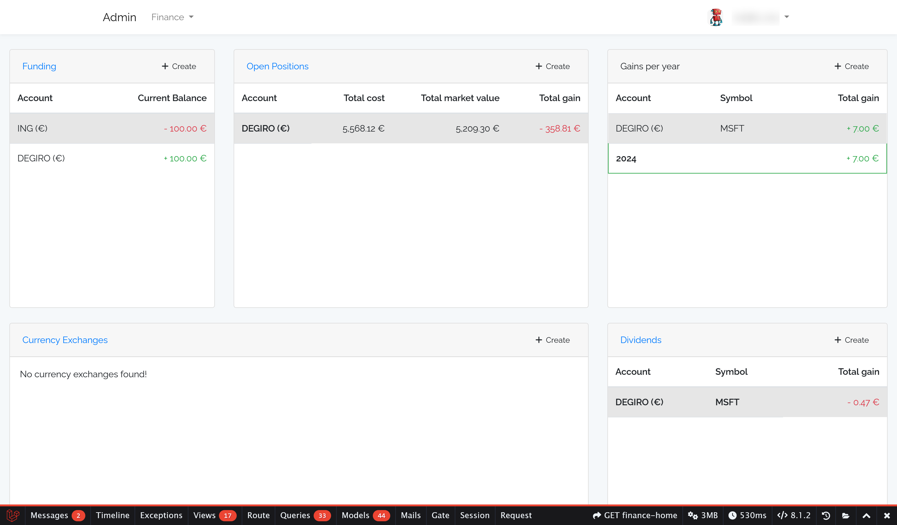
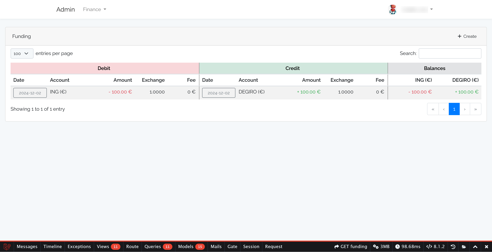
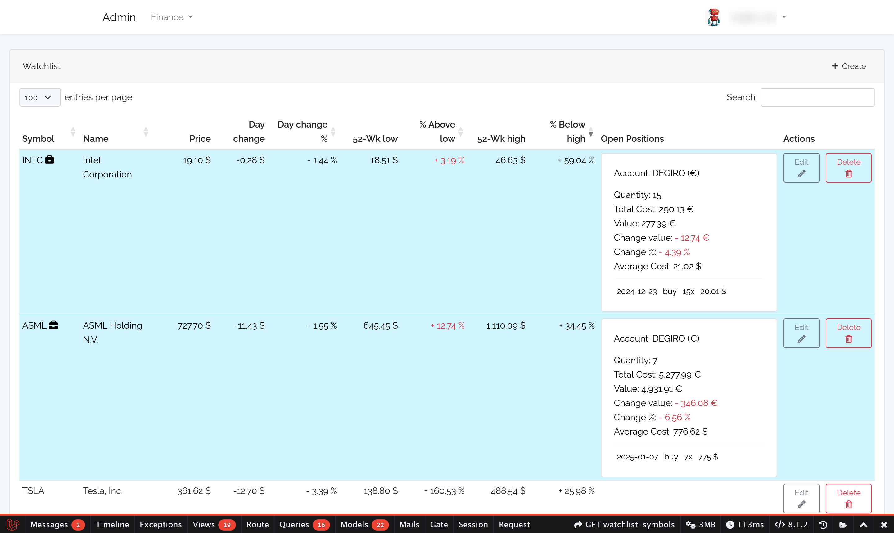
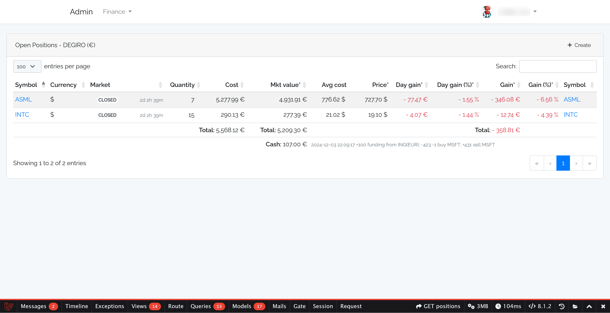
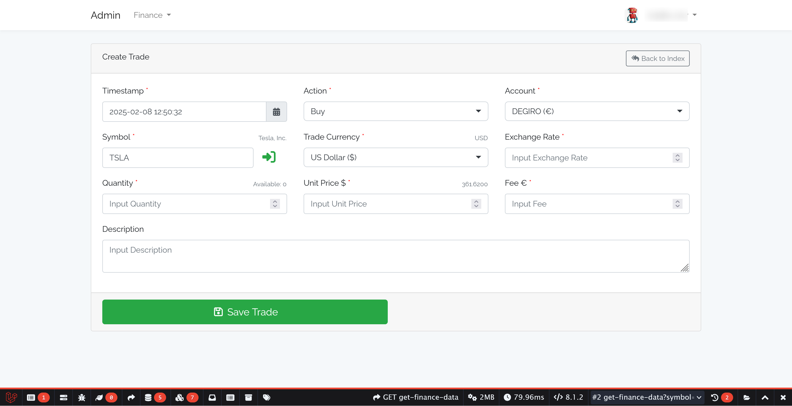

# Laravel Package MyFinance2

Laravel package for managing my finances

- account
- currency
- ledger
- funding
- watchlist
- trades
- positions
- cash
- dividends
- timeline


## Images











More images in the [images folder](images).


## Installation instructions

```bash
sudo apt-get install php-intl php-dom php-mysql php-mbstring php-gd htop colordiff

mysql -uroot -p
    CREATE DATABASE [MYFINANCE2_DB_DATABASE];
    CREATE USER '[MYFINANCE2_DB_USERNAME]'@'localhost' IDENTIFIED WITH mysql_native_password BY '[MYFINANCE2_DB_PASSWORD]';
    GRANT ALL PRIVILEGES ON [MYFINANCE2_DB_DATABASE].* TO '[MYFINANCE2_DB_USERNAME]'@'localhost';

    -- For foreign key constraints
    GRANT SELECT ON [DB_DATABASE].users TO '[MYFINANCE2_DB_USERNAME]'@'localhost';
    GRANT REFERENCES ON [DB_DATABASE].users TO '[MYFINANCE2_DB_USERNAME]'@'localhost';
    FLUSH PRIVILEGES;

    exit

mysql -u[MYFINANCE2_DB_USERNAME] -p [MYFINANCE2_DB_DATABASE] # use [MYFINANCE2_DB_PASSWORD] set above


#NOTE Execute the following if the Database Migration was not already run in the main package
php artisan migrate --pretend
php artisan migrate
# php artisan migrate:rollback # If needed
```

### Get market status (used by /positions)

```bash
sudo chmod 775 src/scripts/market_status.py
sudo chown :www-data src/scripts/market_status.py

sudo apt-get update
sudo apt install python3-pip
# pip install pandas-market-calendars
sudo pip install pandas-market-calendars

# Test
./src/scripts/market_status.py 'LSE'
```

### Install curl-impersonate to avoid '429 Too Many Requests' responses

```bash
mkdir ~/curl-impersonate/
cd ~/curl-impersonate/
wget https://github.com/lwthiker/curl-impersonate/releases/download/v0.6.1/libcurl-impersonate-v0.6.1.x86_64-linux-gnu.tar.gz
tar -xf libcurl-impersonate-v0.6.1.x86_64-linux-gnu.tar.gz

sudo su
cd /usr/local/lib/
ln -s /home/$USER/curl-impersonate/libcurl-impersonate-chrome.so .
ls -la /usr/local/lib/libcurl-impersonate-chrome.so
```

### Prepare account overview and symbol charts

```bash
cd ~/Repositories/laravel-admin/storage/
sudo chown -R :www-data app
# sudo chmod -R 775 app/*
sudo chmod -R 775 app
```

### Get historical data

```bash
# Clear cache
sudo rm -rf storage/app/charts/*
sudo chown $USER:www-data -R storage/framework/
sudo chmod g+w -R storage/framework/
php artisan cache:clear && php artisan config:cache

# Daily prices per symbol (and exchange rates) from Yahoo Finance (NOT in crontab)
sudo su - www-data -s /bin/bash -c "export LOG_CHANNEL=stdout; cd /home/$USER/Repositories/laravel-admin/ && php artisan app:finance-api-cron --historical --start=2026-01-08 --end=2026-01-18"

# Daily account overview (cost, market value, change, cash) per account; needs the prices above, so start
# the --historical range a few days earlier
sudo su - www-data -s /bin/bash -c "export LOG_CHANNEL=stdout; cd /home/$USER/Repositories/laravel-admin/ && php artisan app:finance-api-cron --historical-account-overview --start=$(date +%Y-%m-%d --date '-8 day') --end=$(date +%Y-%m-%d --date '-1 day')"

# One symbol (e.g. after a stock split): overwrites the range with today's split-adjusted prices, redraws its chart
sudo su - www-data -s /bin/bash -c "export LOG_CHANNEL=stdout; cd /home/$USER/Repositories/laravel-admin/ && php artisan app:finance-api-cron --historical --symbol=SYMBOL --start=2025-01-01"
```

The single-symbol backfill is also in the UI: **Populate historical data** in a symbol's expand-chart modal (on
positions or the watchlist) refills 2025-01-01 to today and redraws the chart.


### Daily tier history (settled tier, tier signals)

```bash
# Rebuild symbol_tier_history: each weekday's tier per traded or watchlist symbol (idempotent upsert).
# Run once after the migration, and again after editing past trades; the hourly --refresh-symbol-performance
# cron rewrites the last 7 weekdays. Derived data: not in the git backup, synced from prod by
# scripts/sync-prod-db.sh (PROD_SYNC_TABLES). (NOT in crontab)

# Dry run: prints the weekdays per tier per symbol, writes nothing (add --symbol=SYMBOL for one symbol)
sudo su - www-data -s /bin/bash -c "cd /home/$USER/Repositories/laravel-admin/ && php artisan finance:tier-history-backfill --user-id=1 --dry-run"
# Real run (default: 2025-01-01 to today; --from / --to to narrow it)
sudo su - www-data -s /bin/bash -c "cd /home/$USER/Repositories/laravel-admin/ && php artisan finance:tier-history-backfill --all-users"
# Compare today's computed basis with the live page (lists differences above 0.5 points)
sudo su - www-data -s /bin/bash -c "cd /home/$USER/Repositories/laravel-admin/ && php artisan finance:tier-history-backfill --user-id=1 --verify-today"
```

- **Tier basis.** Every symbol is tiered on its trailing 1Y market return (`MYFINANCE2_TIER_BASIS=market`, the
  default); `own` restores the legacy rule (owned positions tiered on your own return). After changing it, clear the
  cache and re-run the backfill.
- **Settled tier.** The tier shown everywhere is the 12-month median of the daily readings. It follows today's reading
  with under 60 weekdays of history or after a lasting drop; a manual override still wins. An outlined "today" badge
  shows today's reading when it differs.
- **Readings on top of the tier**, one chip per symbol on the watchlist Tier line and column and in the
  peak-proximity page, inbox and emails:
  - *Range-bound* (`RangeBoundPattern`, `watchlistsymbols.range_bound`): a stock you trade well that swings widely
    but ends the year flat. TRIM near the 52-week high, ADD near the low (BUY when not held).
  - *Weak tier in profit* (`WeakTierProfit`, `watchlistsymbols.weak_tier_profit`): a held Rust / Bronze position in
    profit. TAKE PROFIT.
  - *Tier signals* (`TierSignalChip`, `watchlistsymbols.tier_history`): today's tier against the last 12 months.
    Rare high SELL / TRIM, rare low ADD / BUY, deteriorating REVIEW; severity in `TierSignalSeverity`.
- **Signal backtest.** `/peak-proximity-alerts/backtest`, or `php artisan finance:tier-signal-backtest --user-id=N
  [--from=Y-m-d] [--rare-share=20] [--consistency=50] [--grid]`, replays these readings on the stored history without
  look-ahead and compares each episode with VUSA.AS 21 / 63 / 126 trading days later. A sanity check, not proof; the
  first results are noted in `TierSignalChip`.
- **Missing prices.** Early 2025 days need 2024 prices; those missing from `stats_historical` are fetched through the
  7-day `HistoricalPriceCache` (never stored), unless `--no-fetch`. A held symbol with no stored close on a day is
  skipped and reported: populate its history and re-run.


### Refresh returns data

```bash
# Pre-cache /returns: past years only when their 4-week cache expired, the current year always (1 hour TTL)
# (In crontab hourly at :24; also run ad hoc when needed)
sudo su - www-data -s /bin/bash -c "export LOG_CHANNEL=stdout; cd /home/$USER/Repositories/laravel-admin/ && php artisan app:finance-api-cron --refresh-returns"

# --force rebuilds every year (after config changes, price overrides, etc.)
sudo su - www-data -s /bin/bash -c "export LOG_CHANNEL=stdout; cd /home/$USER/Repositories/laravel-admin/ && php artisan app:finance-api-cron --refresh-returns --force"
```

**Missing-price email.** When a recomputed year values a held position at 0 for lack of a price (no `price_overrides`
entry and no close within 7 days before Jan 1 / Dec 31; typically a delisted symbol), the command logs a WARNING and
emails the account owner (`MYFINANCE2_ALERTS_EMAIL_TO`, else the owner's email), again only when the gaps change or
once a day while they persist. The returns page and `test_all_held_positions_have_a_price` flag it too. Fix it by
adding the missing closes to `price_overrides` (and the symbol to `delisted_symbols`), then run the `--force` refresh.


### Enable finance-api-cron for better performance & maintaining a complete week of historical account data

```bash
cd ~/Repositories/laravel-admin/
>storage/logs/finance-api-cron.log
chown :www-data storage/logs/finance-api-cron.log
ls -la storage/logs/finance-api-cron.log
tail -f storage/logs/finance-api-cron.log

sudo apt install cpulimit

sudo su
crontab -e

#############
# Purpose: Keeps your portfolio data fresh with live market prices
# - refreshQuotes(): Fetches current market prices for all symbols (stocks) in your trades, dividends, and watchlist
# - refreshExchangeRates(): Fetches current exchange rates for all currency pairs used in multi-currency trades
# - refreshAccountOverview(): Calculates and persists current account statistics (total cost, market value, change, cash balance) and builds real-time charts

* * * * * ( sleep 5; su - www-data -s /bin/bash -c "export LOG_CHANNEL=stdout; export LD_PRELOAD=/usr/local/lib/libcurl-impersonate-chrome.so; export CURL_IMPERSONATE=chrome116; cd [USER_HOME]/Repositories/laravel-admin/ && cpulimit -l 50 -- php artisan app:finance-api-cron >> [USER_HOME]/Repositories/laravel-admin/storage/logs/finance-api-cron.log 2>&1" )

# Uncomment the next line if you want to have twice-per-minute updates
#* * * * * ( sleep 35; su - www-data -s /bin/bash -c "export LOG_CHANNEL=stdout; export LD_PRELOAD=/usr/local/lib/libcurl-impersonate-chrome.so; export CURL_IMPERSONATE=chrome116; cd [USER_HOME]/Repositories/laravel-admin/ && cpulimit -l 50 -- php artisan app:finance-api-cron >> [USER_HOME]/Repositories/laravel-admin/storage/logs/finance-api-cron.log 2>&1" )
#############

#############
# Purpose: Maintains a complete week of historical account performance data for trend analysis and recovery after downtime
# For each historical date:
# - Recalculates account statistics as they were on that specific date
# - Persists: cost, market value, change, cash balance per account
# - Rebuilds historical chart data points

# Run the job every day at 06:01 => get the past week
HISTORICAL_START=$(date +%Y-%m-%d --date '-8 day')
HISTORICAL_END=$(date +%Y-%m-%d --date '-1 day')

01 06 * * * su - www-data -s /bin/bash -c "export LOG_CHANNEL=stdout; export LD_PRELOAD=/usr/local/lib/libcurl-impersonate-chrome.so; export CURL_IMPERSONATE=chrome116; cd [USER_HOME]/Repositories/laravel-admin/ && cpulimit -l 50 -- php artisan app:finance-api-cron --historical-account-overview --start=${HISTORICAL_START} --end=${HISTORICAL_END} >> [USER_HOME]/Repositories/laravel-admin/storage/logs/finance-api-cron.log 2>&1"

# Run the job 150s after reboot
@reboot sleep 150 && su - www-data -s /bin/bash -c "export LOG_CHANNEL=stdout; export LD_PRELOAD=/usr/local/lib/libcurl-impersonate-chrome.so; export CURL_IMPERSONATE=chrome116; cd [USER_HOME]/Repositories/laravel-admin/ && cpulimit -l 50 -- php artisan app:finance-api-cron --historical-account-overview --start=${HISTORICAL_START} --end=${HISTORICAL_END} >> [USER_HOME]/Repositories/laravel-admin/storage/logs/finance-api-cron.log 2>&1"
#############

#############
# Purpose: Pre-caches returns data for all years to ensure fast page loads
# - Past years (2016-2025): Only refreshes if cache expired (4 weeks TTL), otherwise skips
# - Current year (2026): Always refreshes (1 hour TTL)
# Benefits:
# - Users get instant page loads when viewing /returns
# - Minimizes Yahoo Finance API calls by leveraging long-term cache for historical data
# - Ensures current year data stays fresh with hourly updates

# Run the job every hour at minute 24
24 * * * * su - www-data -s /bin/bash -c "export LOG_CHANNEL=stdout; export LD_PRELOAD=/usr/local/lib/libcurl-impersonate-chrome.so; export CURL_IMPERSONATE=chrome116; cd [USER_HOME]/Repositories/laravel-admin/ && cpulimit -l 50 -- php artisan app:finance-api-cron --refresh-returns >> [USER_HOME]/Repositories/laravel-admin/storage/logs/finance-api-cron.log 2>&1"

# Run the job 250s after reboot
@reboot sleep 250 && su - www-data -s /bin/bash -c "export LOG_CHANNEL=stdout; export LD_PRELOAD=/usr/local/lib/libcurl-impersonate-chrome.so; export CURL_IMPERSONATE=chrome116; cd [USER_HOME]/Repositories/laravel-admin/ && cpulimit -l 50 -- php artisan app:finance-api-cron --refresh-returns >> [USER_HOME]/Repositories/laravel-admin/storage/logs/finance-api-cron.log 2>&1"
#############

#############
# Purpose: Pre-caches watchlist symbol performance tags (gains, windows, metrics) for all users
# - Clears and rebuilds the 2-hour performance cache for every user
# - Ensures /watchlist-symbols page loads instantly without on-the-fly gain computation
# - Cache TTL: 2 hours; cron re-warms it hourly

# Run the job every hour at minute 54 (staggered from --refresh-returns at :24)
54 * * * * su - www-data -s /bin/bash -c "export LOG_CHANNEL=stdout; export LD_PRELOAD=/usr/local/lib/libcurl-impersonate-chrome.so; export CURL_IMPERSONATE=chrome116; cd [USER_HOME]/Repositories/laravel-admin/ && cpulimit -l 50 -- php artisan app:finance-api-cron --refresh-symbol-performance >> [USER_HOME]/Repositories/laravel-admin/storage/logs/finance-api-cron.log 2>&1"

# Run the job 400s after reboot (after stats-cron at 350s)
@reboot sleep 400 && su - www-data -s /bin/bash -c "export LOG_CHANNEL=stdout; export LD_PRELOAD=/usr/local/lib/libcurl-impersonate-chrome.so; export CURL_IMPERSONATE=chrome116; cd [USER_HOME]/Repositories/laravel-admin/ && cpulimit -l 50 -- php artisan app:finance-api-cron --refresh-symbol-performance >> [USER_HOME]/Repositories/laravel-admin/storage/logs/finance-api-cron.log 2>&1"
#############
```


### Setup stats-cron for cleanup

```bash
cd ~/Repositories/laravel-admin/
>storage/logs/stats-cron.log
chown :www-data storage/logs/stats-cron.log
ls -la storage/logs/stats-cron.log
tail -f storage/logs/stats-cron.log

sudo su
crontab -e

#############
# Prevents accumulation of stale real-time statistics, maintains clean database
# - cleanupStatsToday(): Deletes old rows from stats_today table (rows in stats_today with data from yesterday or before)

# Run the job every hour at minute 42
42 * * * * su - www-data -s /bin/bash -c "export LOG_CHANNEL=stdout; cd [USER_HOME]/Repositories/laravel-admin/ && cpulimit -l 50 -- php artisan app:stats-cron >> [USER_HOME]/Repositories/laravel-admin/storage/logs/stats-cron.log 2>&1"

# Run the job 350s after reboot
@reboot sleep 350 && su - www-data -s /bin/bash -c "export LOG_CHANNEL=stdout; cd [USER_HOME]/Repositories/laravel-admin/ && cpulimit -l 50 -- php artisan app:stats-cron >> [USER_HOME]/Repositories/laravel-admin/storage/logs/stats-cron.log 2>&1"
#############
```


### finance:peak-proximity-alerts

Emails an exit hint when an open position is near its peak: within 2% of the 3M peak, 5% of the 6M, 8% of the 1Y or
10% of the 2Y. The full rule set is on the `/peak-proximity-alerts` page.

- **Gate.** Only a weak settled tier (Rust or Bronze) with a meaningful window (6M, 1Y or 2Y) near peak emails.
  Strong tiers show in the inbox as informational; a 3M-only signal is context.
- **Same command, same opt-in, inbox and history**, whatever the tier:
  - *Range-bound* (`PeakProximityRangeSignals`): TRIM in the top 30% of the 52-week range (`RANGE_HIGH`), ADD in the
    bottom 30% (`RANGE_LOW`), BUY in the bottom 30% for a symbol you exited (`RANGE_BUY`). No near-peak alert. ADD
    and BUY email; TRIM is an inbox card only (no edge in the backtest), unless listed in
    `MYFINANCE2_PEAK_PROXIMITY_RANGE_EMAILS`.
  - *TAKE PROFIT* (`PeakProximityTakeProfitSignals`, `TAKE_PROFIT`): a weak tier in profit, near peak or not, in
    place of the near-peak alert. HIGH with a meaningful window near peak or RSI overbought.
  - *Tier signals* (`PeakProximityTierSignals`, `RARE_HIGH` / `RARE_LOW` / `DETERIORATING`). Inbox cards for your
    awareness, not emailed, unless listed in `MYFINANCE2_PEAK_PROXIMITY_TIER_SIGNAL_EMAILS` (e.g. `RARE_HIGH`).
  - On a day both would email, an emailed tier signal goes first and the near-peak one waits.
- **Cadence.** One email when an alert opens, then reminders until dismissed: near-peak every 7 / 3 / 1 days with
  one / two / three long windows near peak (a new long window emails at once); the others every
  `range_reminder_days` / `take_profit_reminder_days` / `tier_signal_reminder_days` (7). The Re-arm button on
  `/peak-proximity-alerts` clears today's record, so a symbol can alert again the same day.
- **Email.** The three watchlist-symbols cards for the symbol plus price, distance from the peak and the gain if sold
  now. The subject leads with the tier, e.g. `[MyFinance2] EZJ.L (Bronze, EXIT) near peak => -4.25% to 6M`, or
  `(Bronze, today Gold, EXIT)` when today's tier differs; reminders are prefixed `Reminder:`.
- **Inbox** (`/peak-proximity-alerts/inbox`): a card per alert, sorted by severity, kept until dismissed. Dismissing
  ends the reminders; a later return to peak opens a fresh alert.

```bash
sudo su
crontab -e

#############
# Purpose: Hourly exit-hint email when an open position is near its 3M/6M/1Y/2Y peak.
# Throttled to one email per symbol per day, so running it every hour is safe.
# Runs at minute :12, clear of the other finance crons (--refresh-returns at :24,
# app:stats-cron at :42, --refresh-symbol-performance at :54), so no two ever run the
# same minute. It reads live quotes through the watchlist dashboard, so it uses the
# same curl-impersonate env and cpulimit as the other finance-api-cron jobs, and logs
# to finance-api-cron.log (its WARNING+ entries then surface in the logs:email-daily-errors digest).

12 * * * * su - www-data -s /bin/bash -c "export LOG_CHANNEL=stdout; export LD_PRELOAD=/usr/local/lib/libcurl-impersonate-chrome.so; export CURL_IMPERSONATE=chrome116; cd [USER_HOME]/Repositories/laravel-admin/ && cpulimit -l 50 -- php artisan finance:peak-proximity-alerts --all-users >> [USER_HOME]/Repositories/laravel-admin/storage/logs/finance-api-cron.log 2>&1"

# Run the job 480s after reboot (staggered after the other finance reboot jobs, the last of which is at 400s)
@reboot sleep 480 && su - www-data -s /bin/bash -c "export LOG_CHANNEL=stdout; export LD_PRELOAD=/usr/local/lib/libcurl-impersonate-chrome.so; export CURL_IMPERSONATE=chrome116; cd [USER_HOME]/Repositories/laravel-admin/ && cpulimit -l 50 -- php artisan finance:peak-proximity-alerts --all-users >> [USER_HOME]/Repositories/laravel-admin/storage/logs/finance-api-cron.log 2>&1"
#############
```

To limit an hourly alert cron to market hours (08:00 to 22:00 server time), use e.g. `12 8-22 * * *`.

```bash
# Preview for one user without sending or recording
php artisan finance:peak-proximity-alerts --user-id=1 --dry-run

# All users with enabled alerts
php artisan finance:peak-proximity-alerts --all-users

# One uniform threshold N% for every window, or specific symbols only
php artisan finance:peak-proximity-alerts --user-id=1 --threshold=10
php artisan finance:peak-proximity-alerts --user-id=1 --symbols=AMD,ETH-EUR
```

**Off by default**: each user enables symbols at `/peak-proximity-alerts` (per symbol or in bulk, optionally until a
date). Env (all optional): `MYFINANCE2_PEAK_PROXIMITY_ENABLED` (true); `MYFINANCE2_PEAK_PROXIMITY_THRESHOLD_3M` /
`_6M` / `_1Y` / `_2Y` (2 / 5 / 8 / 10); `MYFINANCE2_PEAK_PROXIMITY_THRESHOLD_PCT` (5, fallback);
`MYFINANCE2_PEAK_PROXIMITY_EMAIL_TO` (the alerts email, then the user's); `MYFINANCE2_PEAK_PROXIMITY_RSI_OVERSOLD`
(30); `MYFINANCE2_PEAK_PROXIMITY_RANGE_REMINDER_DAYS` / `_TAKE_PROFIT_REMINDER_DAYS` / `_TIER_SIGNAL_REMINDER_DAYS`
(7); `MYFINANCE2_PEAK_PROXIMITY_TIER_SIGNAL_EMAILS` (none: the tier signals that email, comma-separated);
`MYFINANCE2_PEAK_PROXIMITY_RANGE_EMAILS` (`RANGE_LOW,RANGE_BUY`: the range-bound signals that email).


### finance:dip-buying-alerts

The inverse of peak-proximity: paces spending a fixed EUR dip-buying pool as the market falls. Damage control for cash
you keep anyway, not a promise to beat staying invested. One engine (`DipBuyingPlanService`) feeds the `/positions`
panel, this email, the settings page `/dip-buying-alerts` and the backtest `/dip-buying-backtest`.

- **Drawdown**: `max(VUSA.AS trailing-peak drawdown, your portfolio drawdown)`.
- **Ladder** (cumulative % of the pool deployed): 10%->30%, 15%->55%, 20%->75%, 25%->90%, 30%->100%.
- **Verdict**: "no dip yet" under 10%, then behind / on plan / ahead of plan (5pp tolerance). VUSA vs its 200-day MA
  is context only; a six-month stall backstop releases idle cash slowly.
- **Email** only on a state change (the band deepens, on plan to behind, the stall backstop activates); never "the
  trend turned".

```bash
sudo su
crontab -e

#############
# Purpose: Dip Buying Plan email when the plan's state changes (the band deepens, you cross from
# on-plan to behind, or the stall backstop activates). Checked hourly but throttled to one email per
# user per day, so running every hour is safe; it just surfaces a state change sooner instead of
# waiting for the close. Off by default; only users who enabled the feature AND the email channel on
# /dip-buying-alerts are processed, so a full run is a no-op for everyone else. The command is
# lightweight (reads the cached drawdown plan, no Yahoo API), runs at minute :33, clear of the other
# finance crons (peak-proximity at :12, --refresh-returns at :24, app:stats-cron at :42,
# --refresh-symbol-performance at :54), and logs to finance-api-cron.log (WARNING+ entries surface in
# the logs:email-daily-errors digest).

33 * * * * su - www-data -s /bin/bash -c "export LOG_CHANNEL=stdout; cd [USER_HOME]/Repositories/laravel-admin/ && cpulimit -l 50 -- php artisan finance:dip-buying-alerts --all-users >> [USER_HOME]/Repositories/laravel-admin/storage/logs/finance-api-cron.log 2>&1"

# Run shortly after boot too (after peak-proximity at 480s), once the caches are warm
@reboot sleep 510 && su - www-data -s /bin/bash -c "export LOG_CHANNEL=stdout; cd [USER_HOME]/Repositories/laravel-admin/ && cpulimit -l 50 -- php artisan finance:dip-buying-alerts --all-users >> [USER_HOME]/Repositories/laravel-admin/storage/logs/finance-api-cron.log 2>&1"
#############
```

```bash
# Preview for one user without sending or recording
php artisan finance:dip-buying-alerts --user-id=1 --dry-run

# All users with the feature + email enabled
php artisan finance:dip-buying-alerts --all-users

# Self-validation backtest: replay your trades through the ladder (CLI mirror of /dip-buying-backtest)
php artisan finance:dip-buying-backtest --user-id=1
php artisan finance:dip-buying-backtest --user-id=1 --from=2025-01-01 --pool=10000
```

**Off by default**: set the pool and enable the feature and the email channel at `/dip-buying-alerts` (an advanced
JSON override replaces the default ladder). Env (all optional): `MYFINANCE2_DIP_BUYING_ENABLED` (true);
`MYFINANCE2_DIP_BUYING_TOLERANCE_PCT` (5); `MYFINANCE2_DIP_BUYING_PEAK_LOOKBACK_YEARS` (3);
`MYFINANCE2_DIP_BUYING_MA_TREND_PERIOD` (200); `MYFINANCE2_DIP_BUYING_STALL_BACKSTOP_MONTHS` (6);
`MYFINANCE2_DIP_BUYING_MIN_EPISODE_DD_PCT` (10); `MYFINANCE2_DIP_BUYING_RSI_NOTE_ENABLED` (false) with
`MYFINANCE2_DIP_BUYING_RSI_OVERSOLD_LEVEL` (30); `MYFINANCE2_DIP_BUYING_EMAIL_TO` (the alerts email, then the user's).
The plan is cached 2h; a settings change clears it, editing the ladder defaults or the drawdown formula needs a
`cache:clear`.


### finance:portfolio-peak-alerts

The portfolio-level counterpart on the way up: emails when the portfolio's EUR gain (`change_EUR`) or return on cost
(`changePercentage_EUR`) is near its rolling 6M / 1Y / 2Y high, a hint to take profit or rebalance. Read from the
stored daily overview chart; the VUSA.AS 2Y distance is context only.

- Each metric is enabled per user. Negative peaks work: EUR gain is measured against `|peak|` (peaks under
  `min_peak_abs_eur` skipped), return % on the index `1 + return/100`.
- Fires when any enabled (metric, window) pair is within its threshold (Return %: 1 / 3 / 5; EUR gain: 10 / 20 / 30),
  then every `reminder_days` (7) while it holds.
- The email and the "Current standing" card on `/portfolio-peak-alerts` show the full metric x window table (3M as
  context only, never fires) to help calibrate the thresholds.

```bash
sudo su
crontab -e

#############
# Purpose: Portfolio Peak Alert email when the portfolio's EUR gain or return on cost is near its
# rolling 6M/1Y/2Y high. Checked hourly but throttled to one email per user per day, so running
# every hour is safe; it just surfaces a trigger sooner. Off by default; only users who enabled the
# feature AND the email channel on /portfolio-peak-alerts are processed, so a full run is a no-op
# for everyone else. The command is lightweight (reads the cached overview chart series, no Yahoo
# API), runs at minute :48, clear of the other finance crons (peak-proximity at :12,
# --refresh-returns at :24, dip-buying at :33, app:stats-cron at :42, --refresh-symbol-performance
# at :54), and logs to finance-api-cron.log (WARNING+ entries surface in the
# logs:email-daily-errors digest).

48 * * * * su - www-data -s /bin/bash -c "export LOG_CHANNEL=stdout; cd [USER_HOME]/Repositories/laravel-admin/ && cpulimit -l 50 -- php artisan finance:portfolio-peak-alerts --all-users >> [USER_HOME]/Repositories/laravel-admin/storage/logs/finance-api-cron.log 2>&1"

# Run shortly after boot too (after dip-buying at 510s), once the caches are warm
@reboot sleep 540 && su - www-data -s /bin/bash -c "export LOG_CHANNEL=stdout; cd [USER_HOME]/Repositories/laravel-admin/ && cpulimit -l 50 -- php artisan finance:portfolio-peak-alerts --all-users >> [USER_HOME]/Repositories/laravel-admin/storage/logs/finance-api-cron.log 2>&1"
#############
```

```bash
# Preview for one user without sending or recording
php artisan finance:portfolio-peak-alerts --user-id=1 --dry-run

# All users with the feature + email enabled
php artisan finance:portfolio-peak-alerts --all-users
```

**Off by default**: enable the feature, the email channel and the per-metric toggles at `/portfolio-peak-alerts`.
Env (all optional): `MYFINANCE2_PORTFOLIO_PEAK_ENABLED` (true); `MYFINANCE2_PORTFOLIO_PEAK_EUR_THRESHOLD_3M` / `_6M` /
`_1Y` / `_2Y` (5 / 10 / 20 / 30) and `MYFINANCE2_PORTFOLIO_PEAK_PCT_THRESHOLD_3M` / `_6M` / `_1Y` / `_2Y`
(0.5 / 1 / 3 / 5; 3M is a reference line only); `MYFINANCE2_PORTFOLIO_PEAK_MIN_PEAK_ABS_EUR` (1000);
`MYFINANCE2_PORTFOLIO_PEAK_REMINDER_DAYS` (7; `0` means every run that finds a trigger, still one email a day);
`MYFINANCE2_PORTFOLIO_PEAK_EMAIL_TO` (the alerts email, then the user's).


### Emails

Every email this package sends, and what sends it. Recipient: `MYFINANCE2_ALERTS_EMAIL_TO`, else the user's email
(the peak-proximity, dip buying and portfolio peak emails each take their own `..._EMAIL_TO` first, see above).

| Kind | Mailable | Sent by |
|------|----------|---------|
| `price-alert` | `PriceAlertTriggered` | `app:finance-api-cron` when an active price alert reaches its target |
| `price-alert-split` | `PriceAlertTriggered` | the same check, instead, when the target is so far from the price that a split is likely |
| `alert-created` | `PriceAlertCreated` | creating an alert, or a batch of suggested ones, on `/price-alerts` |
| `alert-paused` | `PriceAlertStateChanged` | pausing or resuming alerts on `/price-alerts` |
| `peak-proximity` | `PeakProximityAlert` | `finance:peak-proximity-alerts`: near peak, range-bound, take profit and tier signal |
| `portfolio-peak` | `PortfolioPeakAlert` | `finance:portfolio-peak-alerts` |
| `dip-buying` | `DipBuyingAlert` | `finance:dip-buying-alerts` |
| `split-applied` | `SplitApplied` | applying (or re-applying) a stock split on `/stock-splits` |
| `returns-missing-quotes` | `ReturnsMissingQuotes` | `app:finance-api-cron --refresh-returns` (see "Refresh returns data") |

**Samples.** `EmailSamples::builders($userId)` builds one sample of each kind above, for the host app to send and
check how they look in a mail client (laravel-admin's `emails:samples` does this, adding its own emails). Built from
the user's real data where that is read-only (the price alert at the live price, today's peak-proximity readings, the
portfolio peak and dip buying figures), else from sample figures (the split, the returns warning). Persists nothing:
no alert fires and no notification, inbox or throttle row is written, so the real alert crons are unaffected. A kind
no data reads that way today is skipped. The caller authenticates as the user (read-only) before building.


### Running tests

Unit tests live in this package; feature tests live in the root project (they need the full Laravel application).

```bash
# Unit tests (in this package project)
# php vendor/bin/phpunit --filter ChartsBuilderMetrics --testdox --debug
php vendor/bin/phpunit --testdox
```


### Others

```bash
#NOTE If there were database entries that didn't have user_id before, execute the following

mysql -u[MYFINANCE2_DB_USERNAME] -p [MYFINANCE2_DB_DATABASE] # use [MYFINANCE2_DB_PASSWORD] set above
    select * from `[DB_DATABASE]`.`users`;

    update `cash_balances` set user_id = [USER_ID] where user_id is null;
    update `dividends` set user_id = [USER_ID] where user_id is null;
    update `ledger_transactions` set user_id = [USER_ID] where user_id is null;
    update `trades` set user_id = [USER_ID] where user_id is null;
    update `watchlist_symbols` set user_id = [USER_ID] where user_id is null;

    -- Optional (add currency exchanges to avoid warnings)
    insert into stats_historical (date, symbol, unit_price, currency_iso_code) values ('2025-01-01', 'EURGBP=X', '0.8268', 'GBP');
    insert into stats_historical (date, symbol, unit_price, currency_iso_code) values ('2025-01-01', 'EURUSD=X', '1.0352', 'USD');
    insert into stats_historical (date, symbol, unit_price, currency_iso_code) values ('2024-12-31', 'EURGBP=X', '0.8268', 'GBP');
    insert into stats_historical (date, symbol, unit_price, currency_iso_code) values ('2024-12-31', 'EURUSD=X', '1.0352', 'USD');
    insert into stats_historical (date, symbol, unit_price, currency_iso_code) values ('2024-12-30', 'EURGBP=X', '0.8268', 'GBP');
    insert into stats_historical (date, symbol, unit_price, currency_iso_code) values ('2024-12-30', 'EURUSD=X', '1.0352', 'USD');
    select * from stats_historical where date = '2025-01-01' and symbol like '%=X';
```
